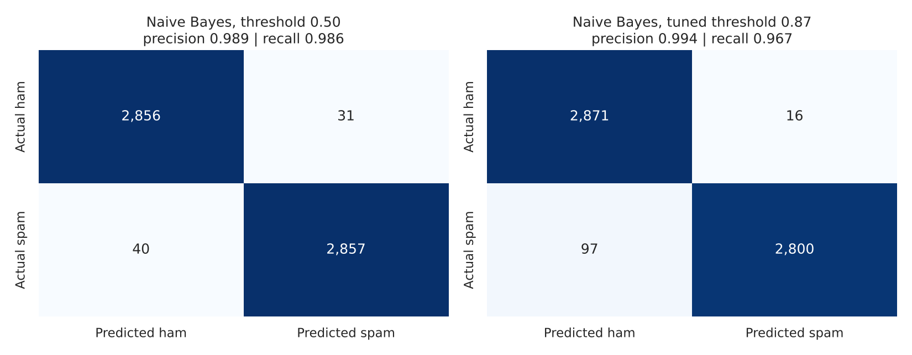
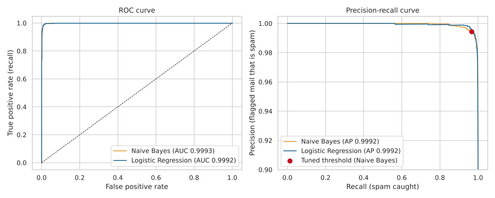
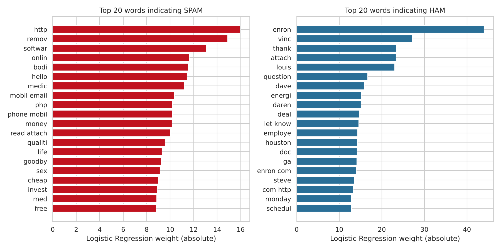

# Spam Email Classifier

A machine learning project that classifies emails as **spam** or **ham** (legitimate) using text preprocessing,
TF-IDF features, and Naive Bayes / Logistic Regression models. It is trained on the real-world
**Enron-Spam** corpus (33,716 emails).

Because a **false positive** (a real email sent to the spam folder) is worse than a missed spam message, the
project goes beyond accuracy: it reports precision and recall, and tunes the decision threshold to keep false
positives low.

The pipeline covers every step of the task:

1. **Load** a labeled dataset of spam and non-spam emails
2. **Clean and preprocess** the text (tokenization, stopword removal, stemming)
3. **Convert text to numbers** with TF-IDF (unigrams and bigrams)
4. **Train** Multinomial Naive Bayes and Logistic Regression
5. **Evaluate** with accuracy, precision and recall, with a threshold tuned to reduce false positives

## Results

Evaluated on a held-out test set of **5,784 emails** (2,887 ham, 2,897 spam) that the models never saw
during training or tuning.

| Model | Accuracy | Precision | Recall | F1 | False positives | Missed spam |
|---|---|---|---|---|---|---|
| Logistic Regression (threshold 0.50) | 98.86% | 98.53% | 99.21% | 98.86% | 43 | 23 |
| Naive Bayes (threshold 0.50) | 98.77% | 98.93% | 98.62% | 98.77% | 31 | 40 |
| **Naive Bayes (tuned threshold 0.87)** | **98.05%** | **99.43%** | **96.65%** | 98.02% | **16** | 97 |

Naive Bayes was selected as the final model because it had the best cross-validated average precision on the
training data (0.9994 vs 0.9988 for Logistic Regression), not because of test results.

### The precision / recall trade-off

At the default threshold (0.50), Naive Bayes wrongly flags **31** legitimate emails as spam. Raising the
threshold to 0.87 cuts that to **16** (a false positive rate of 0.55%), at the cost of missing **57 more spam
messages** (97 missed instead of 40). Accuracy drops by 0.7 points, but the errors move from the costly kind
to the cheap kind.

The threshold was chosen on **out-of-fold predictions from the training data only**: the lowest threshold with
at least 99.5% precision. The test set was not used to pick it. On the test set the precision came out at
99.43%, close to the 99.5% target, which is normal sampling variation.





Both models are very close (ROC AUC 0.999). Logistic Regression's best regularisation strength reached the top
of the search grid (`C=1000`), so it could be tuned slightly further, but it already trails Naive Bayes in
cross-validation.

### What words signal spam?

Logistic Regression weights show which (stemmed) words push an email toward spam or ham:

- **Spam:** `http`, `remov` (remove), `softwar`, `onlin`, `medic`, `money`, `cheap`, `free`, `sex`
- **Ham:** `thank`, `attach`, `question`, `deal`, `schedul`, plus company-specific words (see Limitations)



### Error analysis

`outputs/misclassified_emails.csv` lists every test email the final model got wrong. Most of the 16 false
positives are chain-letter forwards ("fw: women really important to read") and promotional newsletters
(Sears, half.com coupons) that the dataset labels as ham. These are borderline even for a human. The missed
spam are mostly obfuscated messages with random word salad or very short text such as "get 200 $ for free no
more". Note: the spam snippets in that file can contain explicit language.

## Data cleaning and preprocessing

| Step | Emails affected | Why |
|---|---|---|
| Exact duplicates | 3,222 removed | Copies in both train and test sets would inflate scores |
| Empty emails | 1 removed | No text to classify |
| Empty after preprocessing | 10 removed | Nothing left after stopword removal |
| Near-duplicates (different raw text, identical processed text) | 1,564 removed | Same leakage problem as above |
| Conflicting labels (same text labelled both spam and ham) | 0 | Checked, none found |

Emails: 33,716 raw, **28,919 after cleaning** (14,482 spam, 14,437 ham). Split 80/20, stratified:
23,135 train, 5,784 test.

**Text preprocessing** (`src/text_processing.py`, shared by training and prediction so they always match):

1. Join subject and body, truncate very long emails to 10,000 characters
2. Lowercase and strip HTML tags
3. Replace URLs and email addresses with placeholder tokens (the presence of a link matters, the exact link does not)
4. Tokenize into alphabetic words (digits and punctuation dropped)
5. Remove stopwords (scikit-learn's English list) and tokens shorter than 2 or longer than 25 characters
6. Porter stemming, so "winning", "wins" and "win" become one feature

Example: `Subject: WINNING!!! Click http://spam.example/win now to claim $1,000,000 <b>FREE</b>` becomes
`subject win click urltoken claim free`.

## Features and models

- **TF-IDF** with sublinear term frequency, `min_df=3`, `max_df=0.9`, vocabulary capped at 100,000 terms.
  Unigrams only vs unigrams plus bigrams was tuned. Bigrams won for both models ("mobile phone", "let know").
- **Multinomial Naive Bayes:** fast, strong baseline for text. Tuned `alpha` (best 0.003).
- **Logistic Regression:** linear model with interpretable weights. Tuned `C` (best 1000).
- Tuning used 3-fold stratified cross-validation on the training set with average precision as the metric.

## Project structure

```
spam-email-classifier/
├── data/
│   └── enron_spam_data.zip        # Enron-Spam dataset (original, unmodified)
├── src/
│   ├── spam_classifier.py         # full pipeline: load, clean, features, train, evaluate
│   ├── text_processing.py         # text cleaning and preprocessing
│   └── predict.py                 # classify new emails with the trained model
├── outputs/
│   ├── spam_model.joblib          # trained model + chosen threshold
│   ├── metrics.json               # all metrics, parameters and cleaning log
│   ├── model_comparison.csv
│   ├── top_words.csv
│   ├── misclassified_emails.csv   # error analysis
│   ├── run_log.txt                # console output of the run that produced these results
│   └── figures/                   # 5 plots
├── requirements.txt
└── README.md
```

## How to run

```bash
# 1. install dependencies (Python 3.10+)
pip install -r requirements.txt

# 2. train, evaluate and save the model (about 5 minutes on 2 CPU cores)
python src/spam_classifier.py

# 3. classify emails with the trained model
python src/predict.py                                  # built-in examples
python src/predict.py "Subject line. Email body here"  # your own text
python src/predict.py --file email.txt                 # a text file
python src/predict.py --csv emails.csv                 # CSV with Subject and Message columns
```

Example output:

```
Model: Naive Bayes | spam threshold: 0.874

[HAM ] spam probability 0.000 | Meeting moved to 3pm: Hi Sarah, can we move tomorrow's project meeting to 3pm?...
[SPAM] spam probability 1.000 | Cheap meds online!!!: Buy cheap viagra and cialis online, no prescription needed...
```

No NLTK corpus downloads are needed. Only the Porter stemmer algorithm is used.

## Limitations

- **The ham class is Enron employees' email.** Words like `enron`, `vince`, `louis`, `daren` and `houston`
  are among the strongest "ham" signals. The model partly learns "looks like Enron business mail", so it
  would likely perform worse on a different organisation's inbox. A dataset-specific vocabulary like this
  is a known weakness of this corpus.
- **The data is old (1999-2005).** Modern spam and phishing (image-only messages, personalised attacks,
  sophisticated impersonation) look different, and the model has never seen them.
- **Text only.** No sender, header, attachment or link-reputation features, which real spam filters rely on.
- **Random split.** Exact and near-duplicates were removed, but emails from the same thread or campaign can
  still land in both train and test sets. A time-based split would be a stricter test.
- **Labels are imperfect.** Some chain letters and promotions are labelled ham, which puts a floor under
  the achievable false positive rate on this dataset.

## Dataset

Enron-Spam, by V. Metsis, I. Androutsopoulos and G. Paliouras, described in
["Spam Filtering with Naive Bayes - Which Naive Bayes?"](https://nes.aueb.gr/ipl/nlp/pubs/ceas2006_paper.pdf)
(CEAS 2006). The single-CSV version used here was prepared by
[MWiechmann/enron_spam_data](https://github.com/MWiechmann/enron_spam_data). The original dataset is at
<http://www2.aueb.gr/users/ion/data/enron-spam/>.

## Tech stack

Python, pandas, NumPy, scikit-learn, NLTK (Porter stemmer), matplotlib, seaborn, joblib
